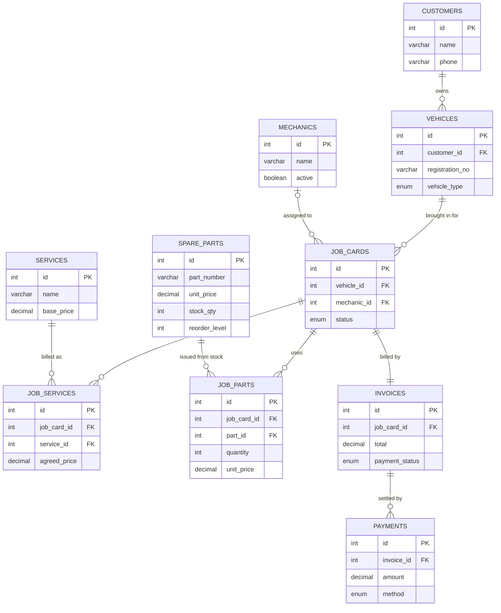

# ER diagram — hand-off sheet

This file is the brief for whoever draws the ER diagram. The database itself is
already designed in [`database_design.md`](database_design.md) and
[`../database/schema.sql`](../database/schema.sql); this document only tracks
the **diagram deliverable**.

| Field | Value |
| --- | --- |
| Owner | _team member name_ |
| Status | **Not started** |
| Due | _date_ |
| Deliverable | `docs/screenshots/er-diagram.png` (plus optional `.svg` / `.drawio`) |

---

## 1. What the diagram must show

1. All **10 entity boxes**: `customers`, `vehicles`, `mechanics`, `services`,
   `spare_parts`, `job_cards`, `job_services`, `job_parts`, `invoices`,
   `payments`.
2. **Primary key** of each entity (underlined or marked `PK`).
3. **Foreign keys** (marked `FK`) with the relationship line drawn to the parent.
4. **Cardinality** on every line: `1 ──< many` (crow's foot notation).
5. Optional but preferred: only the important non-key attributes (name, phone,
   status, totals, prices) — the diagram should stay readable on one slide.

## 2. Relationships to draw

Use exactly these — they match the foreign keys in `schema.sql`:

| # | Parent | Child | Cardinality | Delete rule |
| --- | --- | --- | --- | --- |
| 1 | `customers` | `vehicles` | 1 : many | RESTRICT |
| 2 | `vehicles` | `job_cards` | 1 : many | RESTRICT |
| 3 | `mechanics` | `job_cards` | 1 : many (optional) | SET NULL |
| 4 | `job_cards` | `job_services` | 1 : many | CASCADE |
| 5 | `services` | `job_services` | 1 : many | RESTRICT |
| 6 | `job_cards` | `job_parts` | 1 : many | CASCADE |
| 7 | `spare_parts` | `job_parts` | 1 : many | RESTRICT |
| 8 | `job_cards` | `invoices` | 1 : 1 (UNIQUE) | RESTRICT |
| 9 | `invoices` | `payments` | 1 : many | CASCADE |

`job_services` and `job_parts` are **associative entities** (junction tables):
they sit between a job card and a catalogue item and carry extra columns
(`agreed_price`; `quantity` + `unit_price`). Do not draw them as plain lines —
draw them as boxes.

## 3. Where to draw it

Pick one, in order of preference:

- **draw.io / diagrams.net** (free): export as PNG 2x into `docs/screenshots/`.
- **dbdiagram.io or Mermaid Live Editor**: paste a Mermaid `erDiagram`, export SVG.
- **MySQL Workbench**: once MySQL is installed, `Database → Reverse Engineer`
  produces the diagram straight from the real tables. Best final output, but it
  needs the database to exist first.

## 4. Draft skeleton (verify before exporting)

A starting point only — check every line against `database/schema.sql`, add the
attributes you want, then export the real diagram. A Mermaid-capable Markdown
viewer or <https://mermaid.live> renders this.

## 5. Definition of done

- [ ] Diagram saved as `docs/screenshots/er-diagram.png` (and `.svg`/`.drawio`
      source next to it if the tool supports it).
- [ ] All 10 entities present, with PK and FK marked.
- [ ] All 9 relationships present with cardinality symbols.
- [ ] `job_services` and `job_parts` shown as boxes, not bare lines.
- [ ] Checked against `database/schema.sql` after the script has been run on
      real MySQL, so the diagram matches the actual tables.
- [ ] Image linked from this file and from `docs/database_design.md`.
- [ ] Owner name and status table at the top of this file updated.
